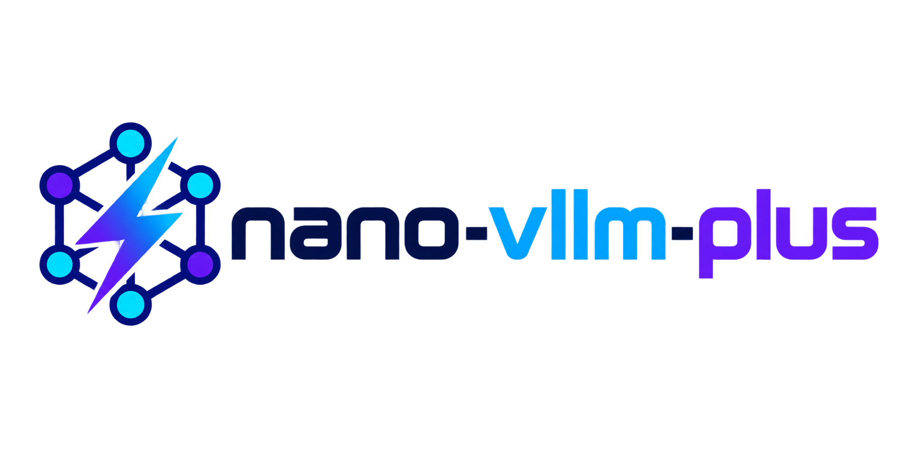

<p align="center">

</p>

<p align="center">
<a href="https://trendshift.io/repositories/15323" target="_blank"></a>
</p>

# nano-vLLM-plus

A lightweight, readable vLLM implementation built from scratch for understanding and experimenting with modern LLM inference. nano-vLLM-plus keeps the core serving path small while including practical optimizations such as paged attention, continuous batching, prefix caching, tensor parallelism, Torch compilation, and CUDA graphs.

The project is designed for developers who want to study how an inference engine works end to end, adapt the implementation for experiments, and benchmark changes against vLLM.

## Key Features

* 🚀 **Fast offline inference** - Comparable inference speeds to vLLM
* 📖 **Readable codebase** - Clean implementation in ~ 1,200 lines of Python code
* ⚡ **Optimization Suite** - Prefix caching, Tensor Parallelism, Torch compilation, CUDA graph, etc.

## Installation

```bash
git clone https://github.com/Taoger-Xu/nano-vllm-plus.git
cd nano-vllm-plus
uv sync
# GPU 推理需要 FlashAttention：
# uv sync --extra cuda
```

## Model Download

To download the model weights manually, use the following command:
```bash
huggingface-cli download --resume-download Qwen/Qwen3-0.6B \
  --local-dir ~/huggingface/Qwen3-0.6B/ \
  --local-dir-use-symlinks False
```

## Quick Start

See `example.py` for usage. Run it with `uv run python example.py`. The API mirrors vLLM's interface with minor differences in the `LLM.generate` method:
```python
from nanovllm import LLM, SamplingParams
llm = LLM("/YOUR/MODEL/PATH", enforce_eager=True, tensor_parallel_size=1)
sampling_params = SamplingParams(temperature=0.6, max_tokens=256)
prompts = ["Hello, nano-vLLM-plus."]
outputs = llm.generate(prompts, sampling_params)
outputs[0]["text"]
```

## Benchmark

See `bench.py` for benchmark.

**Test Configuration:**
- Hardware: 1× NVIDIA A100-SXM4 (80GB)
- Model: Qwen3-8B
- Total Requests: 256 sequences
- Input Length: Randomly sampled between 100–1024 tokens
- Output Length: Randomly sampled between 100–1024 tokens

**Performance Results:**
| Output Tokens | Time (s) | Throughput (tokens/s) |
|---------------|----------|-----------------------|
| 133,966       | 44.54    | 3007.95               |


## Star History

[](https://www.star-history.com/#Taoger-Xu/nano-vllm-plus&Date)